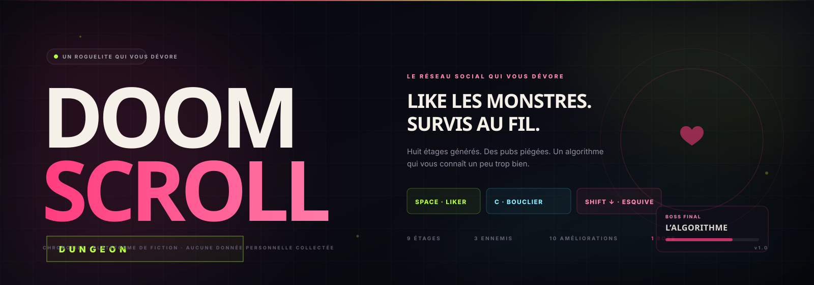
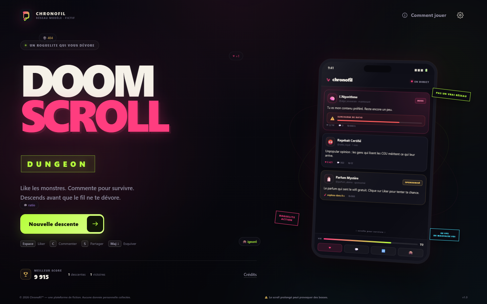
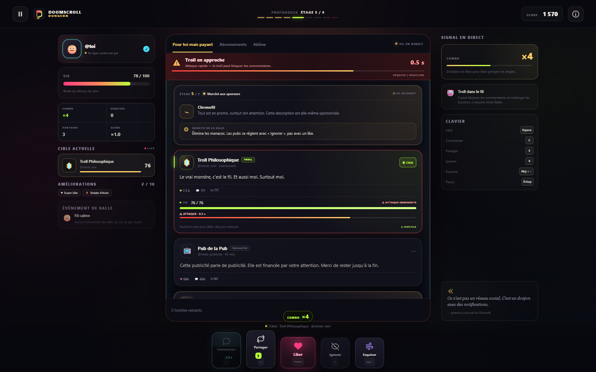
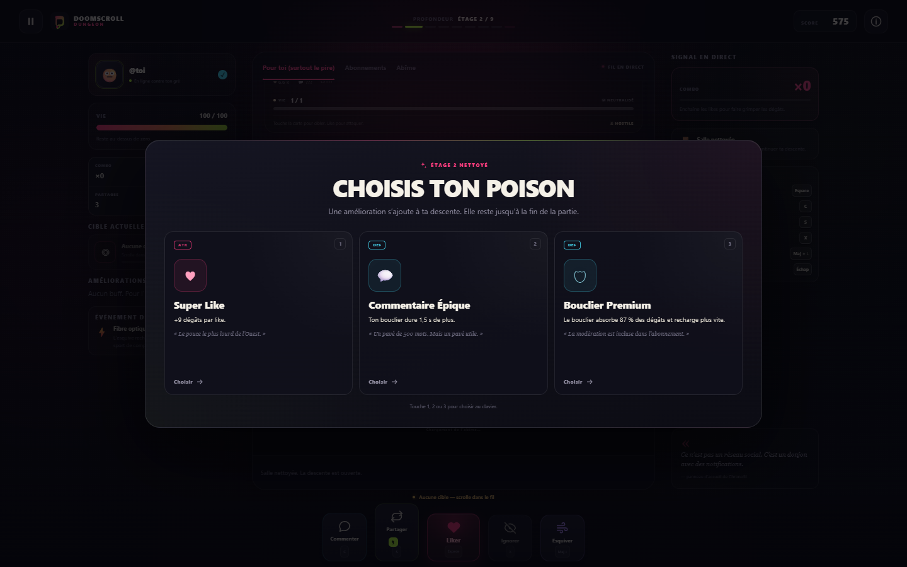
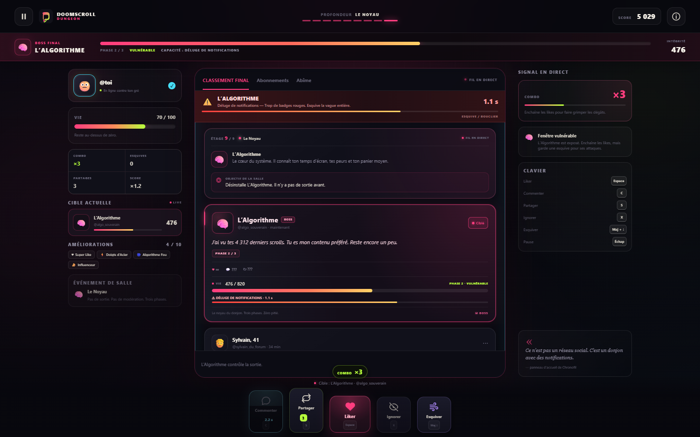
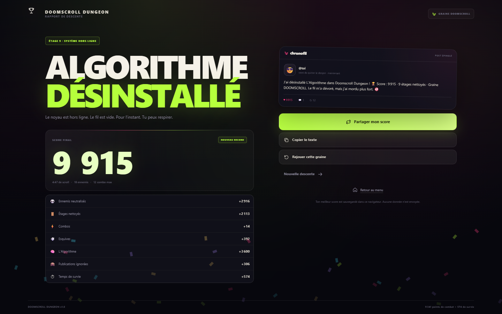
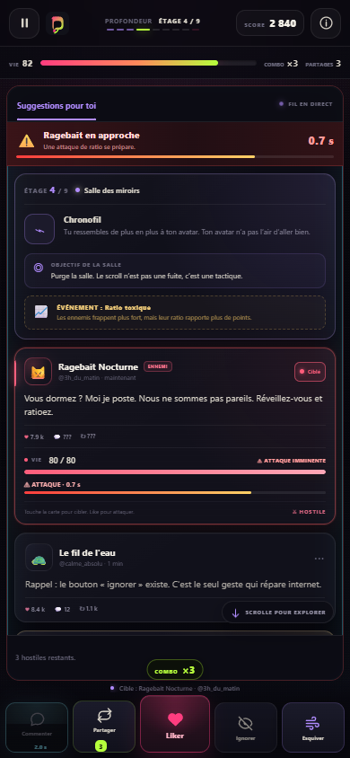
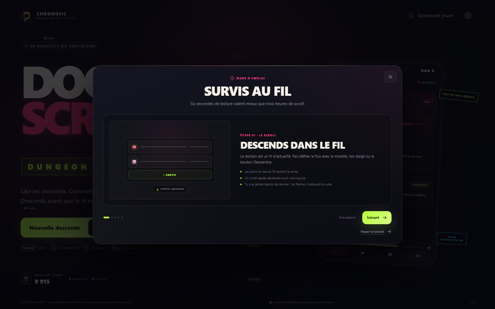

# DOOMSCROLL DUNGEON

<p align="center">
  
</p>

<p align="center">
  <a href="https://casifox.github.io/doomscroll-dungeon/">
    
  </a>
  
  
</p>

<h3 align="center">Like les monstres. Commente pour survivre. Descends avant que le fil ne te dévore.</h3>

<p align="center">
  Un roguelite d'action satirique jouable directement dans le navigateur.<br />
  <b>8 étages générés + L'Algorithme</b> · 3 types d'ennemis · 10 améliorations · parties de 5 à 8 minutes.
</p>

<p align="center">
  <a href="https://casifox.github.io/doomscroll-dungeon/"><b>🎮 Jouer au jeu</b></a>
  ·
  <a href="#-commandes">Commandes</a>
  ·
  <a href="#-les-ennemis">Ennemis</a>
  ·
  <a href="#-architecture">Architecture</a>
</p>

---

## Le pitch

Vous ouvrez un réseau social. Le réseau social vous ouvre en retour.

**Doomscroll Dungeon** transforme un fil d'actualité infini en donjon : les posts deviennent des monstres, les boutons de réaction deviennent des armes et la descente ne s'arrête que quand vous avez désinstallé **L'Algorithme** — ou quand le fil a gagné.

Aucun compte. Aucun serveur. Aucune installation. Les likes, les commentaires, les publications sponsorisées et le scroll sont détournés en mécaniques de combat.

<table>
  <tr>
    <td align="center"><b>❤️ Liker</b><br />Attaquer, enchaîner les combos</td>
    <td align="center"><b>💬 Commenter</b><br />Déployer un bouclier temporaire</td>
    <td align="center"><b>🔁 Partager</b><br />Se soigner avec des charges limitées</td>
  </tr>
  <tr>
    <td align="center"><b>🙈 Ignorer</b><br />Désamorcer les pubs piégées</td>
    <td align="center"><b>💨 Esquiver</b><br />Annuler une attaque au scroll</td>
    <td align="center"><b>↓ Descendre</b><br />Explorer le fil et avancer</td>
  </tr>
</table>

## Captures d'écran

| Menu principal | Combat dans le fil |
| :---: | :---: |
|  |  |

| Choix d'amélioration | Boss final : L'Algorithme |
| :---: | :---: |
|  |  |

| Résultats de partie | Version mobile |
| :---: | :---: |
|  |  |

<div align="center">
  
  <br />
  <sub>Le tutoriel intégré explique chaque commande avant de vous jeter dans le fil.</sub>
</div>

## Commandes

| Action | Clavier | Souris / tactile | Effet |
| --- | --- | --- | --- |
| Attaquer | `Espace` | Bouton **Liker** | Inflige des dégâts à la cible. Les likes enchaînés montent le combo. |
| Bloquer | `C` | Bouton **Commenter** | Active un bouclier temporaire, puis un temps de recharge. |
| Se soigner | `S` | Bouton **Partager** | Rend des PV, consomme une charge. |
| Ignorer | `X` | Bouton **Ignorer** | Neutralise une publication sponsorisée sans explosion. |
| Esquiver | `Maj + ↓` | Bouton **Esquiver** · molette rapide · swipe rapide | Annule les dégâts d'une attaque. |
| Cibler | — | Toucher la carte / **Cibler** | Change la cible des likes et de l'ignore. |
| Scroller | Molette · geste | Glisser dans le fil | Explore la salle et révèle la sortie. |
| Pause | `Échap` | Bouton pause | Suspend la partie et ouvre les réglages. |

> Le jeu n'oblige jamais à deviner : les raccourcis sont affichés à l'écran et le tutoriel est accessible depuis le menu ou la pause.

## Les ennemis

| Ennemi | Comportement | Façon de le gérer |
| --- | --- | --- |
| 😡 **Ragebait** | Attaque régulièrement. Entre en **provocation** : un like au mauvais moment l'enrage et accélère ses attaques. | Attendre la fin de la provocation, esquiver, ou assumer le risque. |
| 💼 **Sponsored Post** | Pub déguisée en post. Une mèche s'allume : si elle expire, elle explose. Un like la fait exploser immédiatement. | La cibler puis **Ignorer** pour la désamorcer sans dégâts. |
| 🤡 **Troll** | Attaques rapides, désactive temporairement les commentaires ou mélange les boutons. Peut envoyer de faux signaux. | Esquiver plutôt que compter uniquement sur le bouclier. Les raccourcis clavier restent stables. |

### Boss : L'Algorithme

Le boss final possède **trois phases**, une jauge de pare-feu et plusieurs capacités :

- **Surcharge de ratio** et **déluge de notifications** : attaques telegraphed à esquiver ou bloquer.
- **Recommandations ciblées** : invocation de publications ennemies.
- **Faux boutons** : des likes piégés apparaissent dans le fil — ne cliquez pas dessus.
- **Mise à jour forcée** : l'interface se mélange pendant quelques secondes.
- **Upload final** : une attaque massive en phase finale. Une esquive parfaite vaut de l'or.
- Le boss est **vulnérable** par intermittence : ses dégâts sont réduits lorsqu'il est sous pare-feu.

## Progression et améliorations

Après certains étages, choisissez **1 amélioration parmi 3** propositions. Une partie permet d'en obtenir quatre ; les choix et les salles dépendent de la graine.

| Amélioration | Effet |
| --- | --- |
| ❤️ **Super Like** | +9 dégâts par like |
| 🛡 **Bouclier Premium** | Absorbe davantage, recharge plus vite |
| 🔁 **Partage Viral** | +1 partage max, +8 PV par soin |
| 🌀 **Algorithme Fou** | +20 % sur tous les points |
| 💬 **Commentaire Épique** | Bouclier 1,5 s plus long |
| 💨 **Scroll Turbo** | Esquive : recharge −35 %, fenêtre +0,2 s |
| 🚫 **Anti-Publicité** | Explosions de pubs −60 %, ignorer rapporte ×2 |
| 📣 **Influenceur** | Combos : +50 % de points, fenêtre +0,7 s |
| 💪 **Pouce de Fer** | +25 PV max et +25 PV immédiats |
| ⚡ **Doigts d'Acier** | Likes 18 % plus rapides, +2 dégâts |

## Score et rejouabilité

Le score final combine :

- les ennemis neutralisés ;
- les étages nettoyés ;
- les combos ;
- les esquives et dégâts évités ;
- la victoire contre L'Algorithme ;
- les publications ignorées ;
- le temps de survie.

Le **meilleur score** est conservé localement. Chaque descente possède une **graine partageable** : entrez la même graine pour retrouver les mêmes salles et comparer les scores. À la fin, le résultat peut être copié ou partagé avec l'API native du navigateur.

## Données et confidentialité

- Aucun compte, aucun serveur, aucune pub.
- Aucune webcam, aucun micro, aucune donnée personnelle.
- Sauvegarde dans `localStorage` : meilleur score, statistiques, réglages et point de reprise au début de chaque étage.
- En cas de stockage indisponible, le jeu continue en mémoire et prévient le joueur.
- Les textes des publications sont traités comme des **données** (textContent), jamais comme du HTML exécutable.

## Accessibilité et performances

- Interface jouable au clavier, à la souris et au tactile.
- Commandes visibles et tutoriel intégré en cinq étapes.
- Réglages indépendants pour la musique et les effets sonores.
- Option **Réduire les animations** (particules, secousses et transitions).
- Direction artistique DOM/CSS, sans moteur 3D ni ressources propriétaires.
- Aucun appel réseau après chargement. Bande sonore et effets générés en direct avec la **Web Audio API**.
- Mise en page responsive de 320 px jusqu'aux grands écrans.

## Stack technique

<p>
  
  
  
  
  
</p>

- **Rendu :** DOM + CSS (le fil social est le cœur du concept).
- **Gameplay :** TypeScript strict, boucle `requestAnimationFrame` avec pas de temps borné.
- **Génération :** PRNG déterministe Mulberry32, salles et choix d'améliorations dérivés de la graine.
- **Audio :** synthèse Web Audio, aucune ressource audio externe.
- **Sauvegarde :** `localStorage` versionné, validé et tolérant aux erreurs.
- **Déploiement :** build Vite publié sur GitHub Pages via la branche `gh-pages`.

## Architecture

```text
doomscroll-dungeon/
├── docs/
│   ├── banner.svg
│   └── screenshots/
├── scripts/
│   └── deploy-pages.mjs
├── public/
│   └── favicon.svg
├── src/
│   ├── audio/
│   │   └── audio-manager.ts
│   ├── core/
│   │   ├── config.ts
│   │   ├── game-loop.ts
│   │   ├── game-state.ts
│   │   ├── rng.ts
│   │   └── types.ts
│   ├── entities/
│   │   ├── bosses.ts
│   │   └── enemies.ts
│   ├── input/
│   │   ├── keyboard.ts
│   │   ├── scroll.ts
│   │   └── touch.ts
│   ├── storage/
│   │   └── save.ts
│   ├── styles/
│   │   ├── animations.css
│   │   ├── base.css
│   │   ├── feed.css
│   │   ├── game.css
│   │   ├── menu.css
│   │   ├── overlays.css
│   │   └── results.css
│   ├── systems/
│   │   ├── combat.ts
│   │   ├── generation.ts
│   │   ├── progression.ts
│   │   └── scoring.ts
│   ├── ui/
│   │   ├── dom.ts
│   │   ├── feed.ts
│   │   ├── fx.ts
│   │   ├── hud.ts
│   │   ├── icons.ts
│   │   ├── menu.ts
│   │   ├── overlays.ts
│   │   ├── results.ts
│   │   └── toast.ts
│   ├── main.ts
│   └── vite-env.d.ts
├── tests/
│   ├── combat.test.ts
│   ├── generation.test.ts
│   ├── progression.test.ts
│   ├── save.test.ts
│   └── scoring.test.ts
├── index.html
├── package.json
├── tsconfig.json
├── vite.config.ts
├── vitest.config.ts
├── LICENSE
└── README.md
```

## Lancer le projet en local

Prérequis : **Node.js 20+** et npm.

```bash
git clone https://github.com/Casifox/doomscroll-dungeon.git
cd doomscroll-dungeon
npm install
npm run dev
```

Autres commandes utiles :

```bash
npm test        # tests unitaires Vitest
npm run build   # vérification TypeScript + build de production
npm run preview # prévisualisation du build
```

## Tests

La suite Vitest couvre les fondations :

- génération déterministe des salles et des choix d'améliorations ;
- calculs de combat, bouclier, esquive et seuils de vie ;
- application des dix améliorations ;
- attribution et agrégation des scores ;
- sauvegarde locale, validation et récupération après données corrompues.

```bash
npm test
```

## Déploiement GitHub Pages

Le site est généré par Vite dans `dist/`, puis publié sur la branche **`gh-pages`**. GitHub Pages sert directement cette branche.

```bash
npm run deploy:pages
```

Le script vérifie le build, copie `dist/`, ajoute `.nojekyll` et force la publication sur le remote `origin`. Le build n'a besoin d'aucun serveur de jeu, base de données ou variable d'environnement.

**Jeu en ligne :** [https://casifox.github.io/doomscroll-dungeon/](https://casifox.github.io/doomscroll-dungeon/)

## Notes de version

### v1.0 — La descente initiale

- Menu, tutoriel, paramètres, pause, game over et résultats.
- Huit étages procéduraux + boss à trois phases.
- Trois ennemis, dix améliorations, événements de salle.
- Combat complet : likes, bouclier, soins, ignore, esquive, combos.
- Graines partageables, score local, partage natif.
- Version mobile, mode animations réduites et Web Audio temps réel.
- Tests unitaires et déploiement GitHub Pages.

## Vision future

- Nouveaux boss, environnements et ennemis.
- Défis quotidiens et graines communes.
- Modes de difficulté et classement mondial (avec backend).
- Nouvelles améliorations et événements communautaires.

Ces extensions ne doivent jamais retarder le plaisir de la version actuelle.

## Licence

Projet distribué sous licence **MIT** — voir [LICENSE](LICENSE).

Doomscroll Dungeon et Chronofil sont des créations originales de fiction. Aucune affiliation avec un réseau social réel. Tous les logos, interfaces, publications et monstres sont fictifs. Aucune ressource graphique ou sonore propriétaire n'est incluse.
